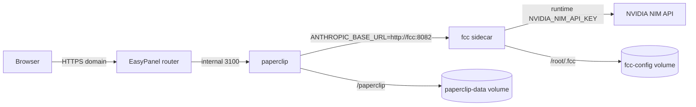

# FCC Docker for Paperclip on EasyPanel

Production-ready repository for building, publishing, smoke-testing, deploying, and rolling back **Free Claude Code (FCC)** Docker images used as an internal sidecar for Paperclip on EasyPanel.

This repo deliberately keeps FCC private: it is reachable only over the Compose network as `http://fcc:8082`. Paperclip agents inherit FCC globally through service-level environment variables, so no agent needs its own NVIDIA key or provider configuration.

## Architecture



Paperclip deployment image: `ghcr.io/paperclipai/paperclip:sha-8af38fb`.

FCC defaults in this repo:

| Setting | Value |
| --- | --- |
| FCC version | `6.19.57` (source of truth: `config/fcc-version.json`) |
| Python | `3.14.10`, installed with `uv` |
| Model | `nvidia_nim/nvidia/nemotron-3-ultra-550b-a55b` |
| FCC port | `8082` (internal only) |
| Adapter | `claude_local`, command `claude` |

## Image naming convention

Images are published to GHCR as `ghcr.io/<owner>/free-claude-code:<tag>`. This repository uses `soatrix` as the default owner; if your repository owner differs, replace `soatrix` in `deploy/docker-compose.yml` and the Makefile examples, or use your lowercase GitHub owner in workflows (the build workflow derives it automatically).

| Tag | Example | Mutable? | Purpose |
| --- | --- | --- | --- |
| Version | `ghcr.io/soatrix/free-claude-code:6.19.57` | No | Immutable release tag |
| Commit SHA | `ghcr.io/soatrix/free-claude-code:sha-abc1234` | No | Preferred immutable deployment tag |
| `latest` | `ghcr.io/soatrix/free-claude-code:latest` | Yes | Convenience tag only; do not use for rollback |

Never delete or overwrite version and sha tags. Rollback depends on them remaining immutable.

## Secrets and variables

Runtime secrets (EasyPanel only, never in the image):

- `NVIDIA_NIM_API_KEY` — supplied to the `fcc` service only.
- `BETTER_AUTH_SECRET` — Paperclip auth secret.
- `PAPERCLIP_TOOL_ACTION_SIGNING_SECRET` — Paperclip tool signing secret.

GitHub Actions:

| Type | Name | Required | Purpose |
| --- | --- | --- | --- |
| Secret | `EASYPANEL_DEPLOY_URL` | Yes for auto/manual deploy | EasyPanel Compose Deployment Trigger URL |
| Variable | `DEPLOY_ON_PUBLISH` | No | Set to `true` to deploy on tag pushes; set to `false` to disable |
| Variable | `EASYPANEL_DEPLOY_METHOD` | No | Optional HTTP method override, defaults to `POST` |

`GITHUB_TOKEN` is provided automatically for GHCR pushes and upstream PR creation. No NVIDIA key, proxy token, or model credential is ever written into a Dockerfile, image layer, or repository file.

## Initial setup

1. **Create the GHCR package by pushing the first image.** Log in to GHCR, then run:

   ```bash
   echo "$GHCR_TOKEN" | docker login ghcr.io -u "$GITHUB_ACTOR" --password-stdin
   make publish FCC_VERSION=6.19.57 IMAGE=ghcr.io/soatrix/free-claude-code:6.19.57
   ```

   `make publish` builds locally, smoke-tests it, then builds and pushes `linux/amd64` + `linux/arm64`.

2. **Add the GitHub secret.** In repository settings, add secret `EASYPANEL_DEPLOY_URL` copied from the EasyPanel Compose service. Optionally add variable `DEPLOY_ON_PUBLISH=true`.

3. **Configure the EasyPanel Compose service using `deploy/docker-compose.yml`.** Use repository path `/deploy` with compose file `docker-compose.yml`. Fill the env vars described in [docs/EASYPANEL.md](docs/EASYPANEL.md). Enable creation of the `.env` file so Compose substitution works.

4. **Add an EasyPanel domain to `paperclip` port `3100`.** Do not add a domain or host port to `fcc`.

5. **Do not expose `fcc` publicly.** It has no published host port and is only reachable as `http://fcc:8082` from Paperclip.

## Build and publish

```bash
# Local build only
make build FCC_VERSION=6.19.57 IMAGE=ghcr.io/soatrix/free-claude-code:6.19.57

# Local smoke test
make smoke IMAGE=ghcr.io/soatrix/free-claude-code:6.19.57

# Build, smoke-test, and publish
make publish FCC_VERSION=6.19.57 IMAGE=ghcr.io/soatrix/free-claude-code:6.19.57
```

Automated publish options:

- Push a tag like `fcc-v6.19.57` to build, smoke-test, publish version/sha/latest tags, and optionally deploy.
- Run the **Build and publish FCC** workflow manually. Leave `fcc_version` blank to read `config/fcc-version.json`; set `publish_latest` and `deploy` as needed.

## Manual deploy and rollback

```bash
# Deploy a specific immutable tag
make deploy IMAGE_TAG=sha-abc1234

# Equivalent GitHub UI/CLI workflow
gh workflow run deploy-easypanel.yml -f image_tag=sha-abc1234 -f dry_run=false

# Roll back to a previous immutable tag
make rollback IMAGE_TAG=6.19.57
```

Local deploy/rollback commands need `EASYPANEL_DEPLOY_URL` exported in your shell. If your EasyPanel Compose service does not accept runtime tag overrides from the trigger payload, set `FCC_IMAGE_TAG=<tag>` in the EasyPanel service environment before triggering. See [docs/OPERATIONS.md](docs/OPERATIONS.md).

## How Paperclip agents inherit FCC globally

`deploy/docker-compose.yml` sets these on the `paperclip` service for every process in that container:

- `ANTHROPIC_BASE_URL=http://fcc:8082`
- `ANTHROPIC_API_KEY=fcc-local`
- `ANTHROPIC_AUTH_TOKEN=fcc-local`
- `CLAUDE_CODE_PROVIDER_MANAGED_BY_HOST=1`
- Model discovery and long-timeout settings for `claude_local`

Therefore, agents using the `claude_local` adapter with command `claude` automatically route through FCC. Do not configure a per-agent base URL or provider.

> **Warning:** never use `http://127.0.0.1:8082` from Paperclip. `127.0.0.1` means the Paperclip container itself, not the FCC sidecar. Use `http://fcc:8082`.

> **Warning:** do not add `NVIDIA_NIM_API_KEY` to Paperclip agents or their env. The NVIDIA key belongs only to the `fcc` service. Agent-level keys cause managed connection conflicts and leak credentials into agent configs.

## Upstream tracking

`scripts/check-upstream.sh` queries `Alishahryar1/free-claude-code`, updates `config/fcc-version.json` when the release changes, and writes release notes. The scheduled workflow opens a PR; it never builds, publishes, or auto-merges.

## Validation

```bash
make lint          # shellcheck, if installed
make fmt           # shfmt, if installed
make smoke IMAGE=...
```

## Documentation

- [EasyPanel setup](docs/EASYPANEL.md)
- [Operations and rollback](docs/OPERATIONS.md)
